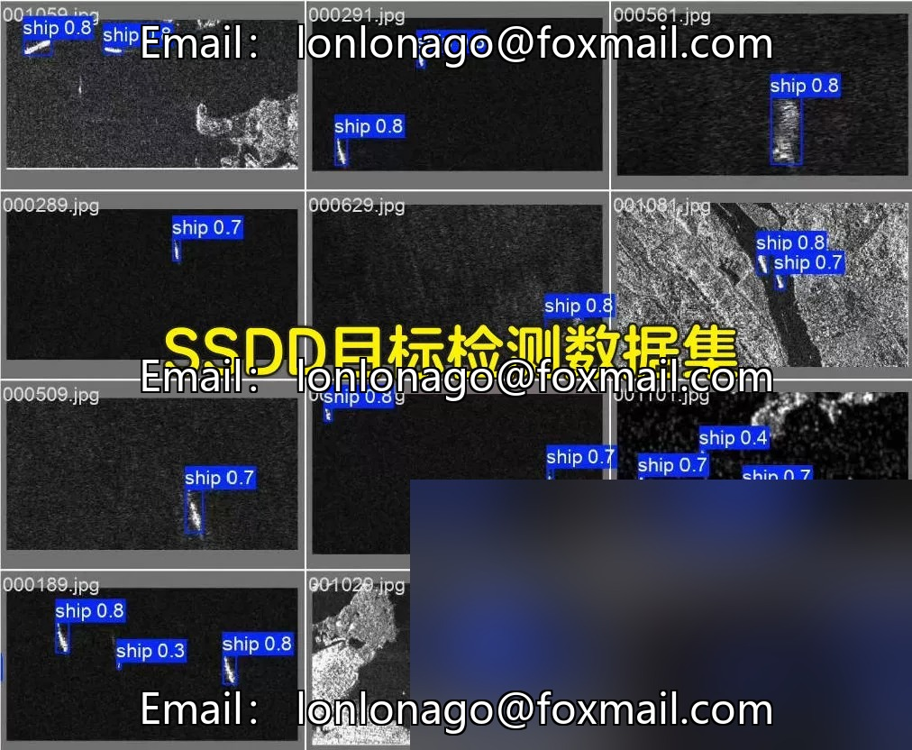
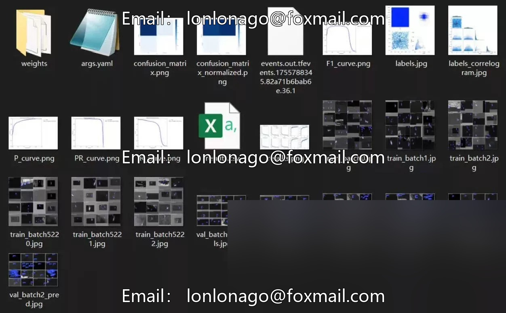
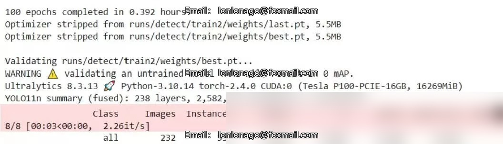

# SSDD object detection dataset in YOLO format, including rotation versions

## Body

SSDD target detection dataset in YOLO format, including rotated versions

[1] Following the original version division, 928 training samples and 232 validation samples;
[2] Only one class, 'ship';
[3] YOLOv11 is trained for 100 epochs, with a map accuracy of 90+;
[4] The compressed package is 40MB;
[5] Shipping YOLOv11n, with results after 100 epochs.

web-based shipment, can be directly photographed and shipped.

The SSDD object detection dataset in yolo format includes rotated versions, with a single class ship, along with training, validation, testing and analysis files; source code, training configurations and weights are also provided.

<!-- AI_ENRICHED -->

## Images

## Payment

Here is a pay link on Stripe ( https://buy.stripe.com/3cs8yP7sY87d0vu9AB ). Please contact me lonlonago@foxmail.com after funding $89, and I will send you a complete data files , thank you!

